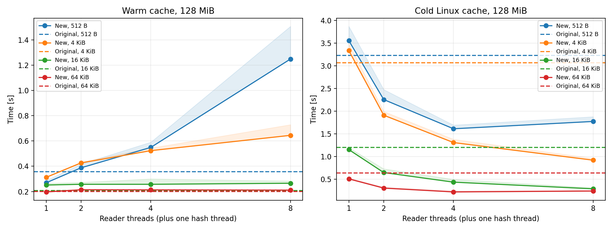
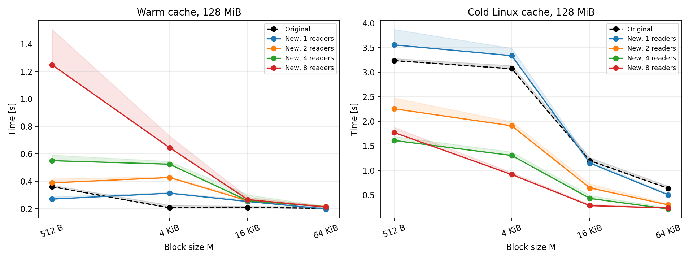
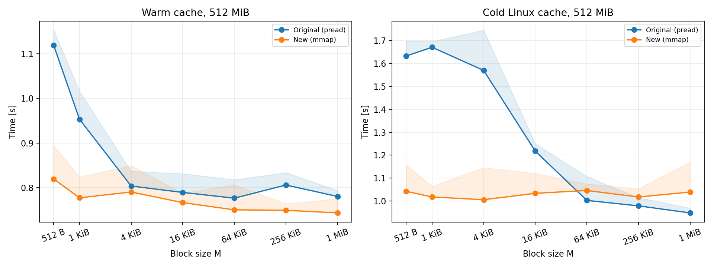
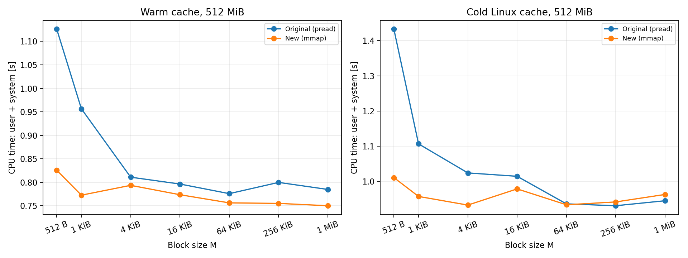
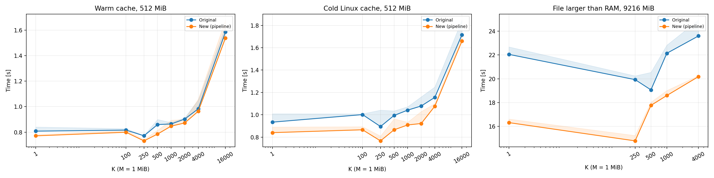
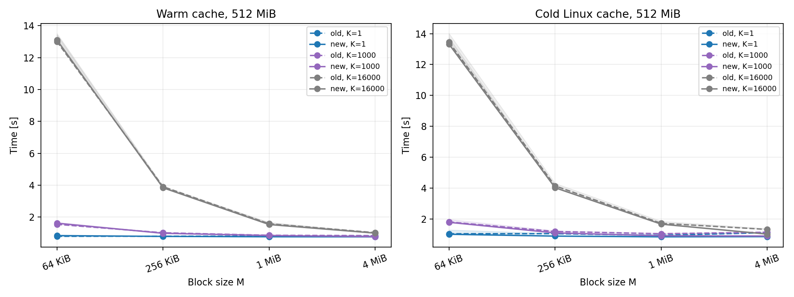

# Projekt 1 - odczyt plików

## Uruchomienie skryptów

Polecenia wykonujemy w `projects/proj1`. Wymagania: Linux/WSL2, Rust edycja 2024 i Python 3.10+.

```bash
cargo fetch --manifest-path src/Cargo.toml
python3 -m venv .venv
.venv/bin/pip install -r scripts/requirements.txt
.venv/bin/python scripts/verify.py

.venv/bin/python scripts/run_experiments.py main --output-dir results/repeat
.venv/bin/python scripts/run_experiments.py stream --output-dir results/repeat
.venv/bin/python scripts/run_experiments.py probes --output-dir results/repeat

.venv/bin/python scripts/plot.py results/repeat/latency.csv results/repeat/throughput.csv \
  results/repeat/pipeline_k.csv results/repeat/pipeline_m.csv \
  results/repeat/pipeline_stream.csv --output plots/repeat
```

`verify.py` kompiluje programy w trybie `release` i porównuje wyniki z niezależnym obliczeniem przez `hashlib`. `run_experiments.py` tworzy pliki z pseudolosowymi danymi i zawiera dokładne parametry eksperymentów. Pomiary należy uruchamiać kolejno. Powyższe polecenia zapisują nowe wyniki w katalogu `results/`.

Przykładowy eksperyment:

```bash
python3 scripts/measure.py latency --file data/example.bin --size-mib 128 \
  --blocks 512 4096 65536 --threads 1 2 4 8 --cache warm cold \
  --repeats 5 --output results/example.csv
```

Dla `pipeline` parametr `--ks` wybiera wartości K; `--probe` włącza osobny pomiar czasów odczytu i obliczeń. `plot.py` tworzy wykresy PNG oraz tabelę `plots/summary.csv`. Same programy można uruchamiać tak:

```bash
src/target/release/latency_new data/example.bin 4096 4
src/target/release/throughput_new data/example.bin 4096
src/target/release/pipeline_new data/example.bin 1048576 1000
```

Argumenty to ścieżka, M w bajtach i - odpowiednio - liczba czytelników (dla latencji) albo K (dla potoku). Domyślnie: M=512 B i 4 czytelników dla latencji, M=512 B dla przepustowości, M=1 MiB i K=1000 dla potoku. Kanały mają stałą pojemność: 256 bloków dla latencji i 2 dla potoku.

## Metoda pomiaru

Pomiary wykonano na Intel Core i7-1355U, z 12 procesorami logicznymi i około 7,58 GiB RAM widocznymi w WSL2. System: Linux 6.6.87.2-microsoft-standard-WSL2, ext4 na wirtualnym `/dev/sdd`, Rust 1.99.1. Pełna konfiguracja w `results/*.json`.

Czas rzeczywisty całego procesu mierzy `time.perf_counter_ns()` (zegar monotoniczny), bez kompilacji i przygotowania cache. Na głównych wykresach każdy punkt to minimum z 5 powtórzeń, a dla pliku większego niż RAM - z 3. Kolejność ustawień w każdej rundzie jest losowana. Pasmo na wykresie sięga od minimum do mediany. Czasy CPU pochodzą z uruchomienia o najmniejszym czasie rzeczywistym. `results/*.csv` zawierają wszystkie powtórzenia, czasy CPU i liczbę bajtów odczytanych z urządzenia według systemu operacyjnego. 

`warm` (ciepłe cache) oznacza wcześniejsze wczytanie całego pliku, a `cold` (zimne cache) - usunięcie jego stron z cache przez `POSIX_FADV_DONTNEED` [Dokumentacja `posix_fadvise`](https://man7.org/linux/man-pages/man2/posix_fadvise.2.html).

## 1. Latencja

`latency_new.rs` zachowuje losowanie z ziarnem 1234. Najpierw wyznacza offsety, następnie dzieli je między czytelników. Każdy wykonuje `read_exact_at` (`pread`) i przesyła bufor kanałem. Wątek główny liczy MD5 i XOR. Do pamięci trafiają offsety i ograniczona liczba bloków, a nie cała zawartość pliku.





Dla pliku 128 MiB i zimnego cache, przy M=4 KiB czasy nowej wersji dla 1, 2, 4 i 8 czytelników wyniosły 3,338; 1,910; 1,306; 0,917 s. Oryginał potrzebował 3,072 s. Współbieżne odczyty skróciły więc czas ponad trzykrotnie. Zwiększanie M również pomaga: przy czterech czytelnikach przejście z 512 B do 64 KiB skróciło czas z 1,611 do 0,216 s, bo potrzeba mniej operacji IO i komunikatów.

Więcej wątków nie zawsze pomaga - dla M=64 KiB czterech czytelników dało 0,216 s, a ośmiu 0,236 s - zbliżyliśmy się do kosztu samego hashowania. Przy M=512 B i ciepłym cache czas rośnie z 0,269 s dla jednego czytelnika do 1,248 s dla ośmiu. Odczyty z RAM są krótkie, a synchronizacja, przekazywanie buforów i przełączanie wątków stają się istotnym kosztem. To powtarzalny efekt, a nie powód do usuwania punktów z wykresu.

Skrócenie całego programu nie oznacza skrócenia pojedynczego odczytu - w osobnym pomiarze `read_exact_at` dla M=4 KiB i zimnego cache średni czas odczytu wyniósł 99 µs przy jednym czytelniku i 196 µs przy ośmiu. Więcej operacji wykonuje się jednocześnie, ale pojedyncza operacja może dłużej czekać w kolejce. Wielowątkowość zwiększyła tu przepustowość, nie zmniejszyła latencji.

Cache zmniejsza latencję bardzo wyraźnie - przy jednym czytelniku i M=4 KiB średni czas odczytu spadł z 99 µs do 1,87 µs. Są to średnie ze wszystkich odczytów w najszybszym z trzech uruchomień diagnostycznych (`latency_probe.csv`), obejmujące także narzut pomiaru (dlatego nie należy zastępować ich ilorazem czasu całego programu przez liczbę bloków, szczególnie przy wielu wątkach).

## 2. Przepustowość

`throughput_new.rs` mapuje plik przez `mmap`, dzieli mapowanie na fragmenty długości M i bezpośrednio hashuje ich zawartość. Po obliczeniu wyniku wykonuje `munmap`; pusty plik obsługuje bez mapowania. Mapowanie zajmuje przestrzeń adresową, więc plik może być większy niż RAM. Plik wejściowy powinien pozostawać niezmieniony podczas odczytu.





Dla 512 MiB, przy ciepłym cache i M=512 B czas spadł z 1,119 do 0,819 s, a dla M=1 MiB z 0,780 do 0,743 s. Zwiększenie M mocno pomaga wersji z `pread`: przy 512 B wykonuje ona ponad milion odczytów, przy 1 MiB tylko 512. W `mmap` zmiana M nie zmienia liczby stron pliku; dla większych bloków dominuje już koszt MD5, więc krzywa jest bliska stałej.

Schemat korzystny dla CPU to wiele małych odczytów, szczególnie danych już obecnych w cache. Dla M=512 B i ciepłego cache czas CPU zmalał z 1,126 do 0,826 s, w tym czas systemowy z 0,265 do 0,020 s. `mmap` usuwa osobny syscall i kopiowanie do bufora dla każdego bloku. Nie usuwa jednak całej pracy systemu: nadal występują mapowanie, obsługa błędów stron i ewentualne IO. Podobnej korzyści można oczekiwać przy wielokrotnym dostępie do drobnych fragmentów już zmapowanych stron; tego wariantu osobno nie mierzyłem. [Dokumentacja `mmap`](https://man7.org/linux/man-pages/man2/mmap.2.html).

Cache skraca oczekiwanie na dane - dla M=512 B czas oryginału zmienia się z 1,632 s przy zimnym cache na 1,119 s przy ciepłym, a `mmap` z 1,043 na 0,819 s. Przy zimnym cache i dużym M `mmap` nie wygrał: dla 1 MiB było 1,040 s w porównaniu z 0,949 s dla `pread`. Duży odczyt amortyzuje narzut syscalla, a mapowanie nadal obsługuje błędy stron. Nie ma więc uniwersalnej przewagi `mmap`. Niewielkich wahań na płaskich fragmentach wykresów nie interpretuję jako osobnych zależności.

## 3. Przeplot IO i obliczeń

`pipeline_new.rs` ma dwa wątki: czytelnik wykonuje kolejne `read_exact_at`, a wątek główny oblicza `stretch_md5` oraz XOR. Łączy je `sync_channel(2)`. Gdy kolejka jest pełna, czytelnik czeka; dzięki temu zużycie pamięci na bufory jest ograniczone do około 4M, także dla plików większych niż RAM.





Dla M=1 MiB i 512 MiB danych nowy program przy K=1 potrzebował 0,772 s z ciepłym cache i 0,840 s z zimnym, w porównaniu z 0,808 i 0,934 s dla oryginału. Przy K=16000 czasy nowej wersji wzrosły do 1,537 i 1,660 s. Potok pomaga uwspółbieżnić odczyt i obliczenia, ale nie zapobiega wzrostowi czas obliczeń przy długim hashowaniu.

Większe M szczególnie pomaga przy dużym K - dla ciepłego cache i K=16000 czas nowej wersji spada z 13,102 s przy 64 KiB przez 3,840 s przy 256 KiB i 1,537 s przy 1 MiB do 0,997 s przy 4 MiB. Dla K=1 różnice są dużo mniejsze.

### K_opt dla M=1 MiB
W modelu z polecenia K_opt jest największą wartością K, dla której obliczenia mieszczą się jeszcze w czasie odczytu. Do tej granicy zwiększanie K nie wydłuża działania potoku, ponieważ wolniejszym etapem pozostaje IO. Aby wyznaczyć taką granicę z pomiarów, należałoby zobaczyć najpierw płaski fragment wykresu, a następnie wyraźny wzrost czasu.

Zmierzone minima czasu nowego programu przedstawia tabela:

| Warunki | K=1 | K=250 | K=500 | K=1000 | K=4000 |
|---|---:|---:|---:|---:|---:|
| 512 MiB, ciepły cache | 0,772 s | 0,732 s | 0,785 s | 0,848 s | 0,964 s |
| 512 MiB, zimny cache | 0,840 s | 0,766 s | 0,865 s | 0,909 s | 1,076 s |
| 9 GiB, plik większy niż RAM | 16,321 s | 14,788 s | 17,769 s | 18,595 s | 20,185 s |

Plik mieszczący się w RAMie: Dla ciepłego cache czas przy K=500 był tylko o 1,8% większy niż przy K=1, a przy K=1000 już o 9,9%. Można więc przyjąć 500 jako orientacyjną wartość K, przy której dodatkowy koszt jest jeszcze niewielki. Nie dowodzi to jednak ukrycia obliczeń za IO: w pomiarze etapów dla K=1 odczyty zajęły 0,062 s, a hashowanie 0,737 s. Wyniki wskazują, że już dla najmniejszego K dominuje koszt obliczeń. Niewielka zmiana czasu dla małych K wynika przede wszystkim z małego kosztu dodatkowych iteracji względem hashowania całego pliku.

Plik większy niż RAM: Dla 9 GiB przy K=500 czas wzrósł o 8,9% względem K=1, a przy K=1000 o 13,9%. Także tutaj pomiar etapów dla K=1 wskazuje na przewagę kosztu hashowania: 14,926 s w porównaniu z 4,677 s na odczyty. Potok nadal pomaga - przy K=1 skrócił czas z 22,051 do 16,321 s - ale na wykresie nie widać wyraźnego zakresu, w którym wzrost K jest całkowicie ukrywany przez odczyt.

Na tej maszynie nie udało się jednoznacznie wyznaczyć K_opt w znaczeniu granicy między ograniczeniem przez IO a ograniczeniem przez obliczenia. Pomiary etapów wskazują na dominację obliczeń już przy K=1, zarówno dla pliku w RAM, jak i dla 9 GiB. Jeśli zamiast tego przyjmiemy umowny limit wzrostu czasu o 5% względem wcześniej zmierzonego K=1, największymi zbadanymi wartościami spełniającymi ten warunek są **K=500 dla 512 MiB** (przy obu stanach cache) i **K=250 dla 9 GiB**. Są to orientacyjne wartości według przyjętej tolerancji, a nie potwierdzone granice K_opt. Zmienność między seriami jest porównywalna z tą tolerancją lub większa, więc dokładniejsze wskazanie optimum na podstawie tych danych byłoby nieuzasadnione.

Dodatkowe wątki: więcej czytelników nie powinno tutaj wiele pomóc, bo odczyt sekwencyjny jest już szybszym etapem. Dodatkowe wątki hashujące mogą pomóc, szczególnie przy dużym K: bloki są niezależne, a częściowe wyniki można połączyć XOR-em. Przyspieszenie skończy się po osiągnięciu limitu CPU, pamięci lub IO. To wniosek z czasów etapów; nie mierzyłem potoku z wieloma konsumentami, a oddana implementacja zgodnie z poleceniem ma dwa wątki.